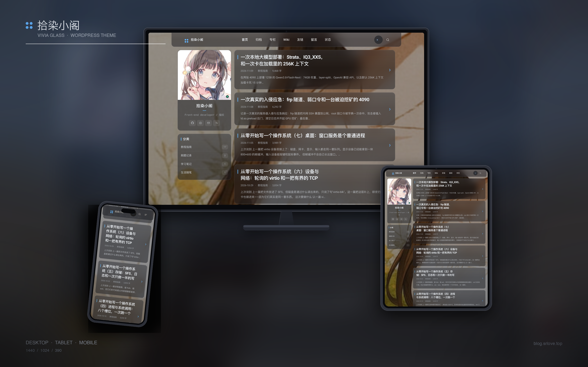
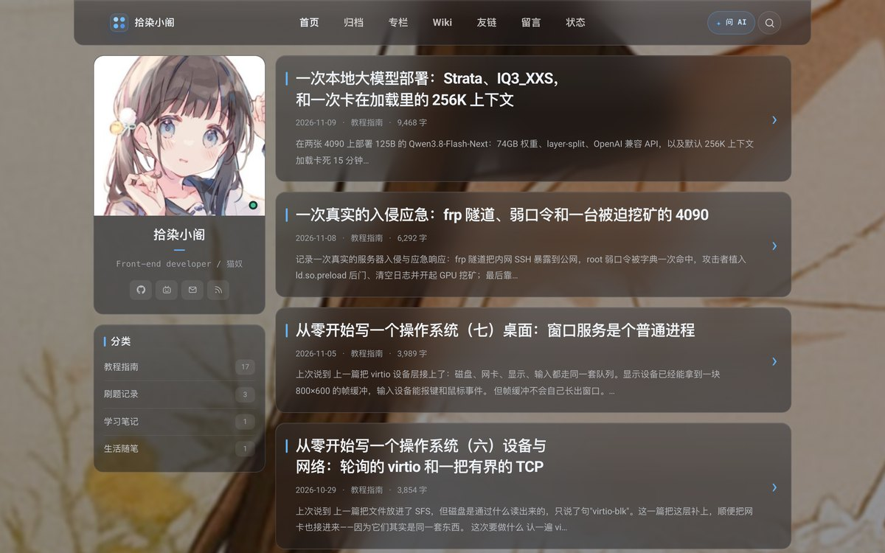
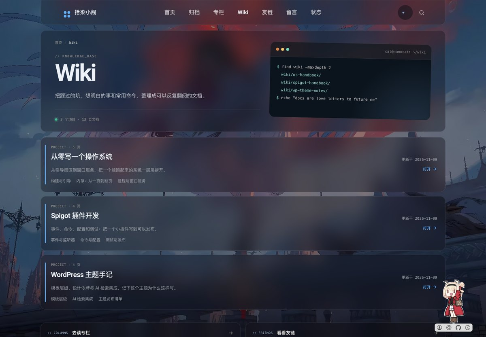
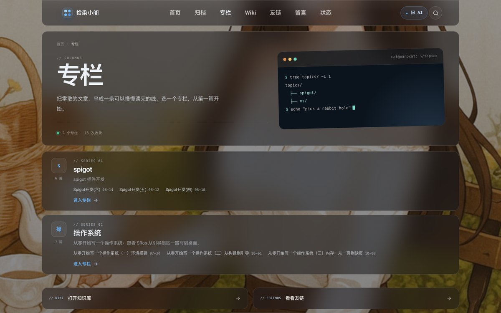
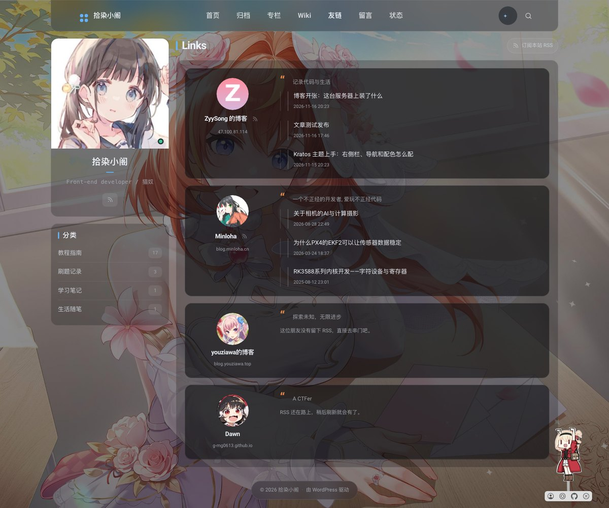
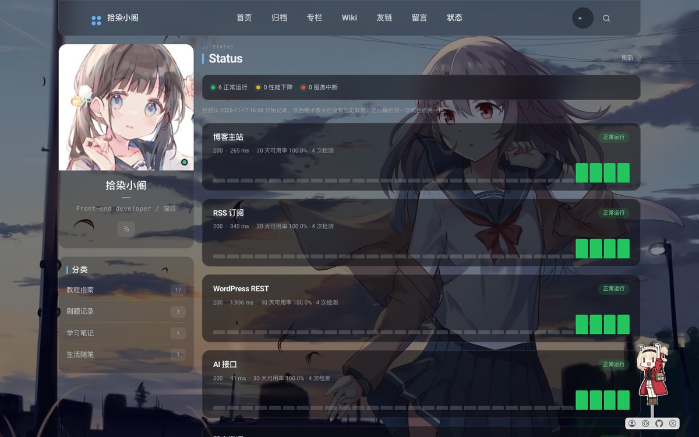

# NanoCat

一款把博客做成玻璃阅读室的 WordPress 主题：Vivia 玻璃拟态、固定随机壁纸、Sakana 角色、Swup 无刷新导航，内置 AI 对话工作台、状态页、友链 RSS 聚合、专栏与 Wiki。



当前版本 **3.5.1**。整站统一 1200px 栅格与 280px 侧栏，面板是半透明磨砂玻璃；内置 7 张本地壁纸，每次刷新随机选一张，不再请求第三方 API。右下角是自托管的 Sakana Widget，页头、弹窗、随机壁纸在站内跳转时保持不动。

## 设计语言

| 项目 | 取值 |
| --- | --- |
| 栅格 | `1200px`，侧栏 `280px`，间距 `16px` |
| 圆角 | `16px`（卡片、面板、页脚胶囊） |
| 玻璃 | `rgba(26,27,34,.50)` + `blur(30px) saturate(1.3)` |
| 边框 | `rgba(255,255,255,.13)`，顶部 5.5% 高光 |
| 主色 | `#63b3ff`，正文 `#c9ced4`，标题 `#edf2f8` |
| 字体 | Roboto（自托管）+ 系统中文字体 |
| 壁纸 | 本地 7 张随机，固定（fixed），加载屏预载 |
| 主题 | 强制暗色，带轻颗粒噪点 |

所有颜色、模糊和圆角集中在 `assets/css/vivia.css` 顶部的 `:root` 变量里，改一处即可换肤。

## 功能

### 阅读与内容

- 首页是整行文章列表：左侧签名竖条、标题、日期 / 分类 / 字数、摘要和箭头。
- 文章页：280px 侧栏 + 玻璃正文，阅读进度、代码复制、分享、上下篇、相关文章、评论。
- 归档：按年 / 月的时间线，蓝色圆点 + 虚线，保留侧栏。
- 搜索：玻璃搜索头 + 结果卡片，侧栏与全站一致。

### 导航与转场

- 页头：玻璃品牌标（4 点收进 30px 方块）、`✦ 问 AI` 胶囊、同尺寸搜索圆钮；移动端收起文字只留图标。
- **Swup 4** 客户端导航：只替换 `#swup`（正文 + 页脚），页头、搜索弹窗、AI 弹窗、Sakana 和随机壁纸保持不变。
- 同步 `<title>`、body class、导航高亮和阅读进度条；切换后重新初始化目录、代码复制、分享和 AI 工作台。
- 鼠标悬停预加载；`/wp-admin`、`/wp-login`、`/feed`、下载文件、外链、`target="_blank"` 和纯锚点不拦截。
- 表单（搜索、评论、AI 提交）保持普通提交。

### 页面

| 页面 | 说明 |
| --- | --- |
| 首页 | 文章列表 + 资料卡 + 分类 |
| 归档 | `/archives/` 年份时间线 |
| 专栏 | `/topics/` 一行一个系列，带最近 3 篇；专栏归档按阅读顺序 |
| Wiki | `/wiki/` 一行一个项目，带子页面；文档页有目录树与上下篇 |
| 友链 | `/links/` 宽卡片：头像 + 签名 + 最近 3 篇 RSS；按更新时间排序 |
| 状态 | `/status/` 六项服务探测、30 天可用率、最近 30 次检测条 |
| AI | `/ai/` 对话工作台、知识地图、最近提问 |
| 留言 / 搜索 / 404 | 独立玻璃布局 |

### 友链与订阅

- 基于 WordPress 链接管理（`wp_links`），RSS 地址填在链接的「RSS 地址」字段。
- 每次刷新读取缓存；主题每 12 小时刷新一次健康状态和文章，后台「链接」页可手动刷新。
- 每个友链有 RSS 图标，页面右上角有「订阅本站 RSS」。
- 不可达的 feed 会自动隐藏图标，避免点开 404。

### 全局歌单（网易云）

- 左下角是**直接播放**的玻璃播放器，不弹浮层、不跳网易云。
- 曲库来自网易云歌单「2026爆火全网的歌曲 持续更新」（ID `4982340006`）中**能直链的 67 首免费曲**。
- 歌单共 200 首，其中 133 首是 VIP / 付费曲，无法直接取音频，因此没有导入。
- 支持播放暂停、上一首、下一首、进度点击、播放列表；唱片旋转。
- 放在 `#swup` 之外，Swup 切页时音乐不断。
- 不自动播放，首次点击播放后才加载音频。
- 歌单数据在 `inc/player.php`，也可以用 `nanocat_music_tracks` filter 替换：

```php
add_filter( 'nanocat_music_tracks', function ( $tracks ) {
    $tracks[] = array(
        'title'  => '我的歌',
        'artist' => '我',
        'src'    => 'https://example.com/song.mp3',
    );
    return $tracks;
} );
```

### 社交

侧栏资料卡读取 Customizer 设置：

- `nanocat_social_github`
- `nanocat_social_bilibili`
- `nanocat_social_email`
- RSS 始终显示

默认值写在 `inc/template-tags.php` 的 `nanocat_get_defaults()`，也可以在「外观 → 自定义 → NanoCat 主题选项」里改。

页脚备案号在「外观 → 自定义 → 页脚 → 备案号」里填写，显示在版权行，点击跳到工信部备案系统。

建站日期在「外观 → 自定义 → 页脚 → 建站日期」里设置，页脚会自动算出一行「小站已经平平安安运行 N 天啦，猫猫一直在 ♥」的小徽章。

### 状态页

- 探测：博客主站、RSS、WordPress REST、AI 接口、静态资源、数据库。
- 每小时 WP-Cron 记录一次，页面刷新可手动强制检测；历史保存在 option 里，只保留 30 天。
- 超过 3 秒记为「性能下降」，4xx 记为降级，超时 / 5xx / 数据库失败记为中断。

### AI

- 全局对话：页头 AI 按钮或 `⌘/Ctrl K`，SSE 流式回答、站内来源、历史会话、停止生成。
- 文章伴读：摘要、三句话总结、列要点、讲人话、考考我；选中正文可追问。
- 后端复用站点的 `/api/ai/ask` 和 `/api/ai/summary`，主题不保存密钥；没有后端时其余功能不受影响。

## 页面截图

| 首页 | Wiki |
| --- | --- |
|  |  |

| 专栏 | 友链 |
| --- | --- |
|  |  |



## 环境要求

| 项目 | 要求 |
| --- | --- |
| WordPress | 6.2 或更高 |
| PHP | 7.4 或更高 |
| 浏览器 | 支持 `backdrop-filter`、CSS 变量和 `color-mix()` 的现代浏览器 |
| 构建 | 不需要，无 npm / 无 CDN |

## 安装

1. 上传 `dist/nanocat.zip` 到「外观 → 主题 → 安装主题」，启用。
2. 「外观 → 自定义 → NanoCat 主题选项」填写首页文案、资料、社交链接与页脚。
3. 「外观 → 菜单」分配主导航和页脚导航。
4. 首次启用会自动创建「归档」「专栏」「友链」「AI 工作台」并套用模板。
5. 新建页面 slug 为 `status`，模板选 **Status**，即可得到 `/status/`。
6. 在「文章 → 专栏」建立系列；在「Wiki」建立项目与子页面；在「链接」加好友并填写 RSS。
7. 到「外观 → NanoCat 内容」点「立即刷新」，抓取友链 RSS 与健康状态。

## 目录

```
assets/css/vivia.css      Vivia 玻璃皮肤与所有页面样式
assets/js/main.js         交互、目录、代码复制、分享
assets/js/ai.js           AI 对话 / 伴读
assets/js/swup-init.js    Swup 导航与页面级重初始化
assets/js/player.js       左下角直接播放器
inc/player.php            歌单数据与播放器标记
assets/js/vendor/swup/    Swup 4 + head / body-class / preload 插件
inc/status.php            状态探测、历史与报告
inc/links.php             友链健康与 RSS 聚合
inc/topics.php            专栏
inc/wiki.php              Wiki 层级
page-status.php           状态页模板
page-topics.php           专栏首页
archive-nanocat_wiki.php  Wiki 首页
taxonomy-nanocat_topic.php 专栏归档
single-nanocat_wiki.php   Wiki 文档页
```

## 部署注意

- PHP 改动后如果服务器开了 OPcache（`validate_timestamps=0`），需要重启 PHP-FPM。
- 静态资源用 `filemtime()` 做版本号；换 CSS / JS 后清一次页面缓存（如 WP Super Cache）。
- Swup 依赖站内链接结构，新增模板时保持 `<main id="primary">` 与 `#swup` 包裹层。
- 表单若不想被客户端接管，放在 `#swup` 外或使用普通提交即可。

## 素材与许可

- 主题代码：GPLv2 or later。
- 本地壁纸收集自随机图源，版权归原作者；公开发布或商用前请替换为自己的授权图片。
- Sakana Widget 与角色图已自托管（角色图内嵌在本地 JS 中），不请求外部 CDN；角色版权归原画师。
- `assets/images/rose-girl.jpg` 与 `vivia-bg.jpg` 为站点自用素材；分发主题时请替换。

## 更新日志

### 3.5.1

- 移动端（≤900px）内页先显示正文，隐藏右侧栏的资料卡、分类与社交链接。
- 首页移动端同步隐藏右侧栏，文章列表直接进入首屏。

### 3.5.0

- 全站切换到 Vivia 玻璃拟态：1200px 栅格、280px 侧栏、磨砂面板与颗粒。
- 接入 Swup 无刷新导航，页头 / 弹窗 / 壁纸 / Sakana 保持常驻。
- 新增 `/status/` 状态页与 30 天检测历史。
- 友链改为宽卡片并显示最近 3 篇 RSS，按更新时间排序。
- Wiki / 专栏改为文章式行列表；详情页统一玻璃面板。
- 新增随机壁纸、Sakana、加载屏、页脚胶囊与四社交图标。
- 左下角新增 67 首网易云免费曲的直接播放器。
- 页脚支持可配置的 ICP 备案号与可爱的「安全运行 N 天」徽章。
- 壁纸全部改到本地，Sakana 提前挂载并盖过加载屏，减少等待。
