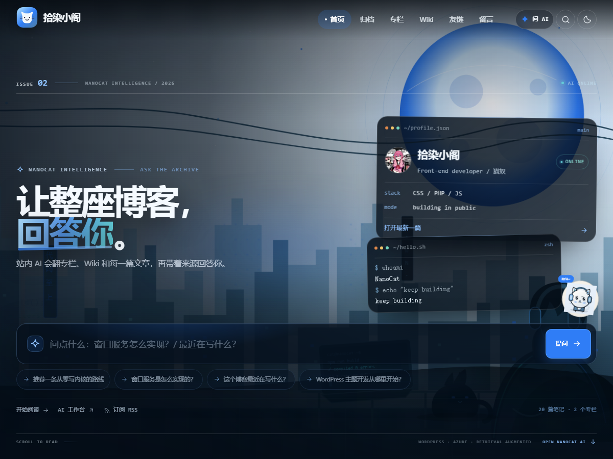

# NanoCat

一款简洁、二次元风、响应式且对开发者友好的 WordPress 博客主题。

写代码，也写猫与生活。



当前版本 **2.0.2**：把博客变成可以对话的站内知识库。新增页头 AI 入口与 `⌘/Ctrl K` 全局流式对话、文章 AI 伴读与选中文字追问、独立 `/ai/` 工作台、AI 主入口式 Hero；继续保留全屏明暗双版背景、个人资料与终端卡、左栏 / 文章 / 右栏三栏首页、专栏、Wiki 与友链 RSS。

## 特性

- **响应式布局**：390 / 768 / 1024 / 1440 px 逐档检查，无横向溢出。
- **浅色与深色模式**：跟随系统，访客选择保存在 `localStorage`，首屏无闪烁；浅色冷白、深色午夜蓝。
- **明暗双版大图**：浅色模式使用晨雾城市 SVG，深色模式使用夜景 SVG；切换主题时头图同步切换，也可在定制器中分别替换。
- **程序员友好**：等宽标签、代码块复制、自动目录、阅读进度、文章字数与阅读时间。
- **首页**：全屏 AI 提问 Hero（标题 / 大输入框 / 建议问题 / 状态栏 / 右侧个人资料与终端卡）+ 左侧资料 / 分类、中间横版文章流、右侧热门 / 标签的三栏结构；1200 / 1024 / 768 / 390 逐档适配；全站导航与首页共用同一条 1600px 刊头轨道；超宽屏首页内容区同步扩展，左右栏在滚动时保持可见；热门文章列表加大行距与字号，标题不再截断。
- **首页小工具**：新增“首页左栏”和“首页右栏”两个小工具区域；不添加时自动使用内置卡片。
- **侧边栏**：默认个人资料 / 分类 / 热门文章 / 专栏 / Wiki / 标签云 / 引用卡片；添加小工具后自动切换。
- **专栏**：文章可加入多个专栏；`/topics/` 汇总所有系列，专栏归档按阅读顺序排列。
- **Wiki**：用层级页面组织项目与文档；`/wiki/` 展示项目，文档页带目录树、上一篇 / 下一篇。
- **友链与 RSS**：基于 WordPress 链接管理，聚合好友最近文章，展示站点健康状态与更新时间。
- **内容后台**：外观 → NanoCat 内容，查看专栏 / Wiki / 友链统计并刷新 RSS 缓存。
- **文章页**：目录滚动高亮、代码复制、分享或复制链接、作者卡片、上下篇、相关文章、评论。
- **AI 原生体验**：页头“问 AI”与 `⌘/Ctrl K` 打开全局对话，SSE 流式回答、站内来源卡片、历史会话与停止生成；兼容站点已有的 `/api/ai` 后端，不要求新增 API Key。
- **文章 AI 伴读**：自动生成摘要，提供“三句话总结 / 列出要点 / 讲人话 / 考考我”动作；选中正文文字即可针对选中内容追问。
- **AI 工作台**：自动创建的 `/ai/` 页面，包含大对话区、知识地图、最近提问与最新文章；首页 Hero 本身就是站内 AI 提问入口。
- **统一 AI 入口**：主题接管旧飞鱼 AI 浮窗所在的位置与能力，移除重复 UI，改用与主题一致的蔚蓝对话界面。
- **完整页面**：归档、搜索、404、页面模板、评论表单都有独立设计。
- **无外部依赖**：无 CDN、无外部字体、无构建步骤，所有插画均为主题内置 SVG。
- **可访问性**：跳过导航、键盘焦点、ARIA 状态、减少动效支持。

## 环境要求

| 项目 | 要求 |
| --- | --- |
| WordPress | 6.2 或更高 |
| PHP | 7.4 或更高 |
| 浏览器 | 支持 CSS 自定义属性、`color-mix()` 的现代浏览器 |
| 构建 | 不需要 |

主题已在 WordPress 7.1.4 + PHP 8.5 上完成页面与交互测试。

## 安装

1. 将 `dist/nanocat.zip` 上传到“外观 → 主题 → 安装主题”。
2. 启用 NanoCat。
3. 打开“外观 → 自定义 → NanoCat 主题选项”，设置首页文案、个人介绍、社交链接和页脚。
4. 在“外观 → 菜单”中分配“主导航”和“页脚导航”。
5. 可选：在“外观 → 小工具 → 首页左栏 / 首页右栏”添加小工具，覆盖首页默认卡片；“侧边栏”供归档页使用。
6. 首次启用后会自动创建“专栏”“友链”和“AI 工作台”页面，并刷新一次固定链接。
7. 在“文章 → 专栏”建立系列；在“Wiki”中建立项目与子页面；在“链接”中加入好友站点与 RSS。
8. 到“外观 → NanoCat 内容”点击“立即刷新”，抓取友链 RSS 与站点状态。
9. AI 页面与对话依赖站点的 `/api/ai/ask`（SSE）与 `/api/ai/summary` 接口；主题不保存密钥，没有后端时其余功能不受影响。

首页默认显示最新文章，不需要额外创建静态首页。

## AI 工作台

- 页头“问 AI”按钮或 `⌘/Ctrl K` 打开全局对话；回答流式输出，并附上检索到的站内文章。
- 首页 Hero 直接放大提问框，并提供具体问题建议；文章页有摘要与伴读动作。
- `/ai/` 是完整工作台，包含对话、知识地图、最近提问和最新文章，首次启用时自动创建。
- 前端只调用站点已有的 `/api/ai/ask` 与 `/api/ai/summary`，不保存 API Key；旧的飞鱼 AI 浮窗会被自动移除。
- 对话历史保存在浏览器 `localStorage` 的 `nanocat-ai-history` 中，不会上传到主题服务器。

## 专栏 / Wiki / 友链

### 专栏

- 文章编辑页右侧勾选“专栏”，可多选。
- 术语设置中可填写图标 URL、排序和文章顺序（最新在前 / 最早在前）。
- `/topics/` 是专栏总览；`/topics/{slug}/` 是对应归档。
- 首页在有文章时显示专栏横条，文章页显示所属专栏与系列卡片。

### Wiki

- “Wiki”是层级文章类型：顶层页面是项目，子页面是文档。
- `/wiki/` 展示所有项目；`/wiki/{project}/` 是一个项目的入口页。
- 文档页侧边栏显示项目树，移动端折叠为“项目目录”。

### 友链

- 使用 WordPress 自带链接管理；每条链接填写 RSS 地址即可聚合最近文章。
- 健康状态与 RSS 内容缓存 6 小时 / 1 小时，并由定时任务每 12 小时刷新。
- 首次添加链接后，到“外观 → NanoCat 内容”手动刷新一次。
- 前台入口是自动创建的 `/links/` 页面。

## 自定义选项

后台“外观 → 自定义 → NanoCat 主题选项”包含：

- **首页 Hero**：开关、顶部小字、标题、介绍、主按钮与次按钮的文案和链接；浅色 / 深色模式头图可分别上传。
- **个人卡片与社交**：身份、简介、GitHub、Bilibili、邮箱。
- **页脚**：页脚文字。
- **强调色**：默认 `#2f7df6`，会同步到按钮、链接、标签与装饰。

首页标题允许安全的内联标签：`<br>`、`<span class>`、`<em>`、`<strong>`、`<b>`。

## 目录结构

```text
nanocat/
├─ assets/
│  ├─ css/main.css             # 前端样式系统
│  ├─ css/ai.css               # AI 对话 / 伴读 / 工作台样式
│  ├─ css/editor.css           # 区块编辑器样式
│  ├─ images/                  # 明暗双版 Hero、猫咪与三张回退封面 SVG
│  ├─ js/main.js               # 主题交互
│  └─ js/ai.js                 # AI 对话、摘要、选中追问
├─ inc/
│  ├─ ai.php                   # AI 配置、资源加载、飞鱼 UI 替换
│  ├─ content-admin.php        # 内容后台、自动建页
│  ├─ customizer.php           # 自定义选项
│  ├─ icons.php                # 内置 SVG 图标
│  ├─ links.php                # 友链 RSS / 健康检查 / 缓存
│  ├─ template-tags.php        # 模板辅助函数
│  ├─ topics.php               # 专栏 taxonomy
│  └─ wiki.php                 # Wiki 文章类型与树
├─ template-parts/
│  ├─ ai-companion.php         # 文章 AI 伴读
│  ├─ ai-console.php           # 可复用 AI 对话控制台
│  ├─ content.php              # 文章卡片
│  ├─ content-none.php         # 空状态
│  ├─ hero.php                 # 首页 Hero
│  ├─ sidebar-profile.php      # 首页左栏个人资料
│  ├─ sidebar-browse.php       # 首页左栏分类
│  ├─ sidebar-topics.php       # 首页左栏专栏
│  └─ topics-strip.php         # 首页专栏横条
├─ 404.php
├─ archive.php
├─ archive-nanocat_wiki.php
├─ comments.php
├─ footer.php
├─ functions.php
├─ header.php
├─ index.php
├─ page.php
├─ page-ai.php
├─ page-links.php
├─ page-topics.php
├─ search.php
├─ searchform.php
├─ sidebar.php
├─ sidebar-left.php
├─ sidebar-right.php
├─ single.php
├─ single-nanocat_wiki.php
├─ taxonomy-nanocat_topic.php
├─ style.css
├─ theme.json
├─ readme.txt
├─ LICENSE
└─ screenshot.png
```

## 本地预览

`preview/index.html` 是一个不依赖 PHP 的静态首页演示，直接双击打开即可。它引用 `../assets` 下的真实主题 CSS、JS 和插画，适合快速查看首页视觉与交互；专栏、Wiki、友链与 AI 对话需要 WordPress 数据和 `/api/ai` 后端，因此不在静态预览中。

## 开发

主题没有构建步骤：

- 样式：编辑 `assets/css/main.css`，设计变量集中在文件顶部的 `:root`。
- 脚本：编辑 `assets/js/main.js` 与 `assets/js/ai.js`，原生 JS，无依赖。
- AI：`inc/ai.php` 通过 `nanocat_ai_config` 过滤器可替换接口地址与文案；对话请求为 `POST {api}/ask`，摘要为 `GET {api}/summary?post=ID`，两者都是站点现有后端。
- 编辑器：编辑 `assets/css/editor.css` 与 `theme.json`。
- 图片：`assets/images/` 下均为 SVG，可直接替换；保留文件名即可继续使用回退逻辑。

主要交互约定：

- 主题切换按钮：`[data-theme-toggle]`，存储键 `nanocat-theme`。
- 搜索弹窗：`#nanocat-search-dialog`，触发器 `[data-search-open]`。
- 目录：`[data-entry-content]` 中的 `h2` / `h3` 自动生成到 `[data-toc-nav]` 和 `[data-toc-nav-mobile]`。
- 代码复制：自动注入 `.code-copy`。
- 移动菜单：`.site-header.is-menu-open` 与 `body.is-nav-open`。
- AI 对话：触发器 `[data-ai-open]`，弹窗 `#nanocat-ai-dialog`，控制台 `[data-ai-console]`，消息 `[data-ai-thread]`。
- 首页 AI 提问：表单 `[data-ai-hero-form]`，输入框 `[data-ai-hero-input]`，建议问题 `[data-ai-hero-prompt]`；提交后复用全局对话。
- AI 会话历史：`localStorage` 键 `nanocat-ai-history`；文章摘要缓存键前缀 `nanocat-ai-summary-`。

## 质量检查

- 37 个 PHP 文件通过 `php -l`。
- `assets/js/main.js` 与 `assets/js/ai.js` 通过 `node --check`。
- WordPress 7.1.4 + SQLite 实际安装测试：首页、文章、页面、归档、搜索、404、评论、专栏、Wiki、友链、AI 工作台与管理页均通过。
- AI 流式回答、来源卡片、文章摘要、选中文字追问、移动端全屏对话与停止生成均通过真实接口测试。
- 24 组页面 / 宽度组合（6 个页面 × 390 / 768 / 1024 / 1440）无横向溢出。
- 浏览器自动化验证：目录展开与跳转、代码复制、分享复制、主题切换、移动菜单遮罩、搜索弹窗打开与 Esc 关闭。
- 真实 RSS 抓取与链接健康检查通过。

## 许可

GNU General Public License v2 or later，详见 [LICENSE](LICENSE)。

主题内置插画、图标与样式均为本项目原创，按同一许可证发布。
